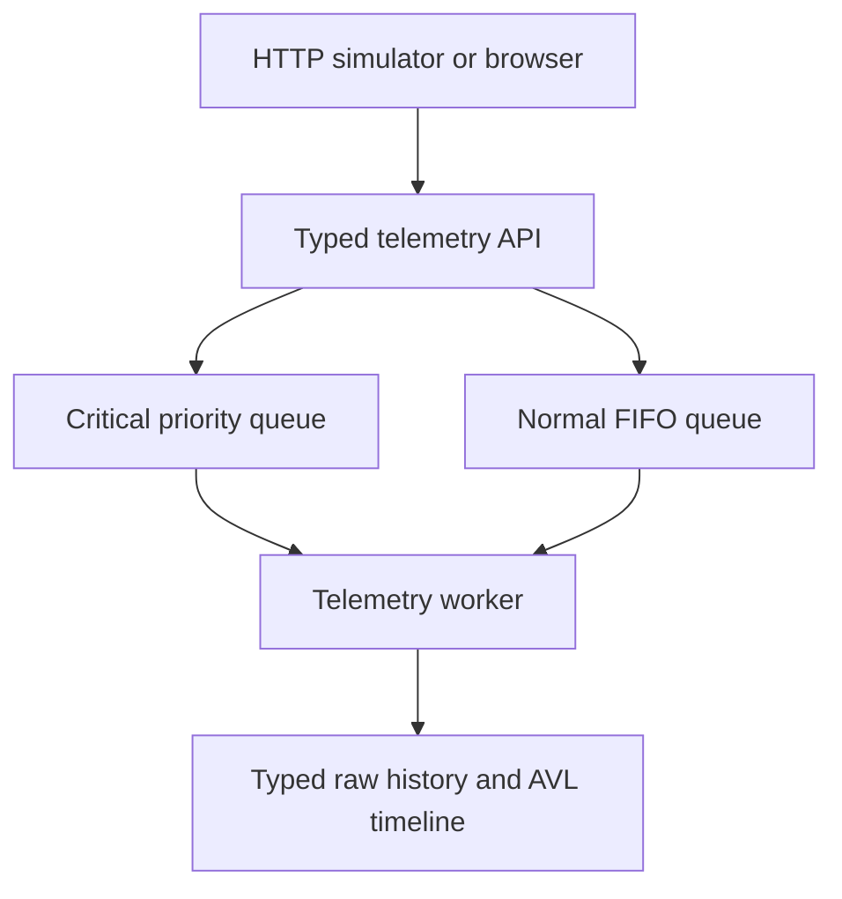

# Smart-X — PROG7312 POE Part 3

**Developed by Antonio Bechev (ST10435330)**

**Module:** PROG7312

Smart-X is a simulated IoT gateway for hydroponic moisture sensors, utility meters and irrigation actuators. The completed application combines typed telemetry ingestion, a real-time command stream and a network topology dashboard. It uses C#/.NET 10, an ASP.NET Core Minimal API and an HTML/CSS/JavaScript client served by the same application.

Part 3 adds an AVL timestamp index, a weighted mesh graph, BFS traversal, Prim's Minimum Spanning Tree (MST), route highlighting, failure simulation and filtered telemetry history.

## Video demonstration

[Watch the Smart-X Part 3 demonstration on YouTube](https://youtu.be/h3mjGzaj2D4).

## Submission documentation

The necessary Part 3 documentation is available in the [`/docs`](docs/) folder:

| Document | Contents |
|---|---|
| [Part 3 report — PDF](docs/SmartX_Part3_Report.pdf) | Submission copy of the implementation and project completion report, including integration challenges, learning outcomes, technology recommendations and references |
| [Part 3 report — Word](docs/SmartX_Part3_Report.docx) | Editable version of the same report |
| [Part 3 AI declaration](docs/SmartX_Part3_AI_Declaration.docx) | AI assistance with algorithms, code, debugging, telemetry history, date filtering and documentation, with example prompts |
| [Feedback and development updates](docs/SmartX_Part3_Feedback_Updates.md) | Feedback record and improvements made for Part 3; no specific corrective lecturer feedback was received for Parts 1 and 2 |
| [API reference](docs/API.md) | Endpoints, request parameters and response behaviour across Parts 1–3 |
| [Data structure explanations](docs/DATA_STRUCTURES.md) | AVL history, weighted mesh graph, BFS, heaps and Prim's algorithm, with source examples and efficiency explanations |
| [Verification record](docs/VERIFICATION.md) | Recorded automated results, commands to reproduce checks and the final browser/container checklist |

Earlier supporting documents are also retained: [Part 1 research report](docs/SmartX_Research_Report.docx) and [earlier AI declaration](docs/AI%20Declaration.docx). Use the Part 3 report and declaration above for the final submission.

## Requirements

- .NET **10 SDK**. The projects target `net10.0`; check with `dotnet --version`.
- A browser and Git.
- Python 3 for the HTTP checks; they use the standard library.
- Docker with Compose for the optional container run.

The application does not require npm packages, a separate frontend server, an external database account, API keys or physical ESP32 hardware.

## Restore, compile and run

Open PowerShell in the repository directory containing `SmartX.sln`:

```powershell
dotnet restore SmartX.sln -m:1
dotnet build SmartX.sln -c Release -m:1
dotnet run --project src/SmartX.Api -c Release --no-build --urls http://localhost:5080
```

Keep the terminal running and open [http://localhost:5080](http://localhost:5080). Ctrl+C stops the application. If port 5080 is occupied, use `--urls http://localhost:5081` and open that address instead. Relative client API URLs continue working.

Use the hosted page rather than opening `index.html` directly. JavaScript modules are served from `src/SmartX.Api/wwwroot`; there is no frontend transpilation step. Stop a running application before rebuilding it if Windows reports a locked output file.

## Application views

| View | Main functions |
|---|---|
| Sensor Data Ingestion and Telemetry | Sensor registration, typed readings, freshness/threshold checks, raw history, attachments, load exercise and meter aggregation |
| Real-Time Command Stream and History | FIFO/critical queues, receipts, live events, device filtering, manual overrides, stack undo and suggested actions |
| Network Topology and Mesh Routing | Weighted mesh diagram, sensor/MAC search, BFS and MST routes, device health, simulated failures and paged telemetry history |

All three views are active. Navigation changes the visible section without reloading the document, so inputs and selections remain available while moving between views. The command stream also saves its selected device and filters in session storage. Topology saves its selected identifier and applied history dates/page size. The topology history returns to its newest page after selecting a different sensor or reloading the page.

## Start a mesh demonstration

1. Open **Network topology** and click **Start 20 sensor demo**. This configures HTTP telemetry for up to the first 20 registered sensors.
2. Enter `ESP32-0004` and click **Find exact identifier**. These example identifiers are created by a fresh installation.
3. Inspect the selected device's mesh status, telemetry status, last reception time and route to `CENTRAL GATEWAY`.
4. Switch **Highlighted route** between **BFS — fewest hops** and **MST — tree route**.
5. Click **Fail next relay** to remove the next intermediate node on the highlighted route. Where an alternative exists, subsequent route calculations use it. A direct gateway route has no intermediate relay, so this button is disabled.
6. Select the failed sensor and click **Clear selected failure** to remove the simulated fault.
7. Use **Fail selected sensor** to demonstrate an unavailable source: both route arrays become empty while its stored history remains readable.

The diagram normally displays up to 40 nodes, including the selected route and nearby nodes. The full selected route is retained if it needs more space. Registry search, metrics, BFS and MST calculations use the complete network. Search is paged; a sensor outside the diagram window can still be selected.

Colours distinguish the gateway, reachable nodes, online-but-unreachable nodes and offline nodes. Green links belong to the current MST; orange links show the selected route. Dashed links touch an offline node. Costs printed on the selected path are generated simulation weights.

The mesh uses actual registered sensor identities, but its connections and costs are generated demonstration data. It is a routing model: HTTP ingestion remains the telemetry transport, and these algorithms do not reconfigure real radios or forward real packets through neighbouring ESP32 devices.

## Mesh availability and health

A sensor is excluded from mesh calculations when it has a simulated failure, is paused, or its telemetry status becomes `Disconnected`. The existing freshness threshold is three times its expected reporting interval. A default five-second sensor becomes disconnected after more than 15 seconds without a reception. Newly registered sensors have an initial reporting grace period; startup seed samples also establish an initial reception time.

Mesh status and telemetry status are shown separately. A simulated mesh failure can coexist with a recent, healthy reading. Clearing the failure restores eligibility, but a paused or stale sensor remains unavailable until its underlying condition is resolved.

The 20-sensor demo does not continuously update all 1,000 initial profiles. Other sensors expire unless they transmit. **Send normal via HTTP** can generate a reading for the selected sensor. Normal processing must be running for a normal queued reading to reach history; critical readings can bypass a paused normal queue.

## Historical telemetry and date-range search

The topology history panel follows the selected sensor. It queries a separate AVL tree for each sensor, using timestamps as keys.

1. Start the demo or click **Send normal via HTTP**.
2. Choose **From**, **To** and a page size, then click **Search history**. Either date can be omitted. Times are entered in the browser's local timezone and converted to ISO timestamps for the API; both boundaries are inclusive.
3. Read the retained count, matching count and displayed row count. The table shows newest readings first on each page.
4. Use **Older readings**, **Newer readings** or **Latest page** to navigate through the retained matches.
5. **Clear range** removes the applied date limits. The newest page refreshes every three seconds while the topology view is visible; older pages remain still until explicitly refreshed or changed.

For a quick paging demonstration, stop the simulator, send a 60-reading batch for the same sensor from **Command stream**, then return to topology and apply a 25-row page size. Batch admission is asynchronous; wait for processing before checking the log.

The AVL timeline contains telemetry successfully processed from the ingestion queues since the server started. Startup preload samples and direct manual actuator-state changes remain in the original typed raw histories rather than this timeline. The UI labels this scope. Empty history means no processed records exist yet, or the date range excludes them.

## Telemetry, queues and commands



Environmental values remain `float`, power values `int`, and actuator values `bool` in `TelemetryPacket<T>`. The HTTP receiver validates types, categories, physical ranges and timestamps. A `202` response confirms queue admission; its receipt must reach `Processed` to confirm storage. A rejected or expired receipt is reported by the receipt endpoint.

Moisture below 10% or above 90%, or power at least 7,500 W, enters the critical lane. Normal traffic is FIFO. The hosted worker checks critical work first every 100 ms and processes up to 100 items per tick. Critical work bypasses waiting normal items and a paused normal queue, but does not interrupt an item already being stored. Timestamp order is independent of processing order.

To demonstrate priority, stop the simulator, pause normal processing, queue a normal batch and send a critical reading. Inspect the processing feed, then resume normal processing. Environmental operating warnings below 20% or above 80% are distinct from the critical scheduling thresholds.

Actuator ON/OFF commands store previous states in a stack. Undo restores the last command; grouped shutdown can be reversed as one command. Suggested actions use explicit sensor/pump links, search-to-command frequency counts and a conditional least-squares moisture trend. Suggestions require a user's decision and are not automatically executed.

## Main data structures

| Structure | Role |
|---|---|
| Custom AVL tree | Balanced per-sensor timestamp insertion, inclusive range retrieval and oldest-record removal |
| Weighted adjacency-list graph | Bidirectional simulated connections between sensor identifiers and the gateway |
| Queue, visited set and predecessor dictionary | BFS reachability and fewest-hop paths |
| `PriorityQueue<MeshLink, int>` | Min-heap used by Prim to select the gateway component's minimum-cost tree |
| FIFO and critical priority queues | Telemetry admission and scheduling |
| Stack | Manual command undo |
| Dictionaries and hash sets | Device lookup, duplicate timestamps, unique alerts and learned associations |
| Generic packets, jagged batches and bounded lists | Strongly typed payloads, variable batch sizes and original raw histories |

BFS minimises hop count. Prim minimises total tree connection cost; it does not guarantee each sensor's individually cheapest path. A disconnected graph has no single spanning tree covering every node: the API returns the gateway's reachable tree and lists unreachable online nodes separately from offline nodes.

Detailed explanations and source examples are in [Data structures](docs/DATA_STRUCTURES.md).

## Bounds and persistence

- A fresh profile directory creates 1,000 sensors with 120 preload samples each. Registration is limited to 5,000 sensors.
- Queue capacity is 10,000 normal packets plus a separate reserve of 1,000 critical packets. A full lane returns HTTP 429. Sustained critical traffic can delay normal work.
- Each AVL timeline retains up to 2,048 entries, deleting the oldest timestamp when necessary. Original typed lists trim their oldest block after exceeding their bound.
- History API pages contain 1–500 records. Their timestamps remain ascending in the response for compatibility with the command-stream chart; the topology table reverses each page for display.
- Profiles and attachment metadata/bytes persist in `DataDirectory`. The default is the build output's `data` directory. For a fixed location, set `$env:DataDirectory = "C:\SmartXData"` before starting.
- Telemetry, queues, undo, simulated mesh failures, pump links and learned patterns are in memory and reset when the server restarts. Startup preload history is regenerated.
- Locks protect the single-process collections. Multi-instance coordination, authenticated devices, durable telemetry and real hardware acknowledgement are outside this local prototype.

## Verification

Run from the repository root, continuing only after each command succeeds:

```powershell
dotnet build SmartX.sln -c Release -m:1
dotnet run --project tests/SmartX.Checks -c Release --no-build
python scripts/http_checks.py
```

C# checks cover the original features, queue/command behaviour, AVL balance/ranges/retention, BFS routing, MST costs/failures and paged history. HTTP checks start an isolated app on port 5089 with temporary profile data and remove it afterwards. They test actual receiver routes, mesh failure/recovery, health timeout, MAC lookup and paged/inclusive history queries alongside the Part 1 and Part 2 workflows.

GitHub Actions builds the solution, runs the C# checks, checks all six client JavaScript files for syntax and runs the HTTP suite. A green run was confirmed for source commit `00f4b9e` on 12 November 2026. This is the latest recorded verification baseline, rather than a claim about a future commit. See [Verification record](docs/VERIFICATION.md).

The optional `scripts/browser_checks.cjs` requires a separately installed Playwright/Chromium environment and covers the earlier Part 1/Part 2 interactions. It has not been extended to verify the Part 3 dashboard. The final topology browser checklist is recorded separately in `docs/VERIFICATION.md`.

## Docker

With Docker and Compose available:

```powershell
docker compose up --build
```

Open [http://localhost:5080](http://localhost:5080). Compose maps localhost port 5080 to container port 8080 and mounts the `smartx-data` volume at `/app/data`. The .NET 10 multi-stage image runs as the `app` user. The HTTP simulator discovers the listening address and uses loopback inside the container.

Stop with `docker compose down`; the named volume retains profiles and attachments. Telemetry and other in-memory state reset when the container restarts. Container execution remains a separate verification item; the confirmed CI workflow does not build or run Docker.

## Project map and documentation

| Location | Contents |
|---|---|
| `src/SmartX.Api/Program.cs` | Dependency injection, receiver and dashboard API routes |
| `Gateway.cs`, `Domain.cs`, `GatewayRealtime.cs` | Profiles, typed raw storage and shared gateway operations |
| `TelemetryInbox.cs`, `TelemetryWorker.cs`, `DeviceSimulator.cs` | Admission queues, hosted processing and actual HTTP simulation |
| `StreamHistory.cs`, `DataStructures/AvlTree.cs` | Indexed chronological history and paging |
| `DataStructures/MeshGraph.cs`, `MeshSpanningTree.cs` | Graph, BFS and Prim implementations |
| `NetworkTopology.cs` | Sensor/health integration, generated connectivity and route/failure API service |
| `src/SmartX.Api/wwwroot/` | Three application views and JavaScript/CSS modules |
| `tests/SmartX.Checks/`, `scripts/` | C# and HTTP checks; optional earlier browser checks |

See [Submission documentation](#submission-documentation) above for the report, declaration, feedback record and technical notes.

- [GitHub repository](https://github.com/ST10435330/ST10435330_POE_Part3_PROG7312)
